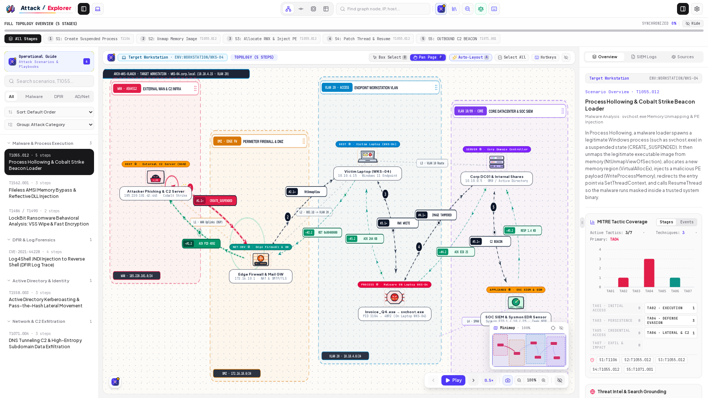
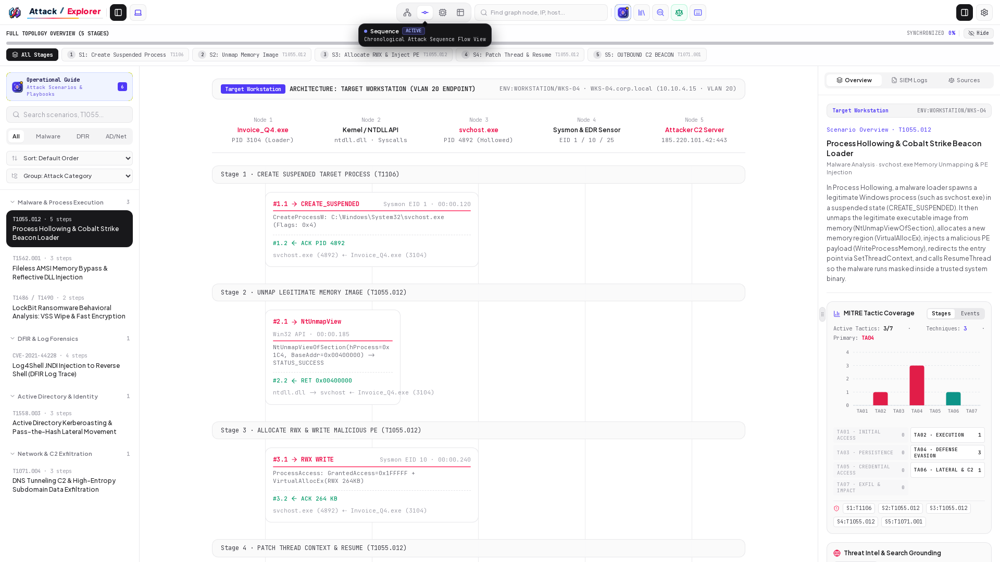
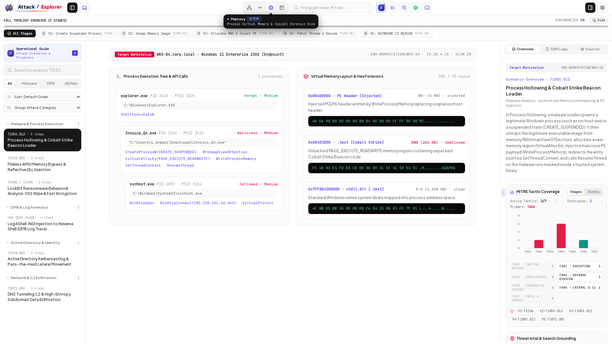
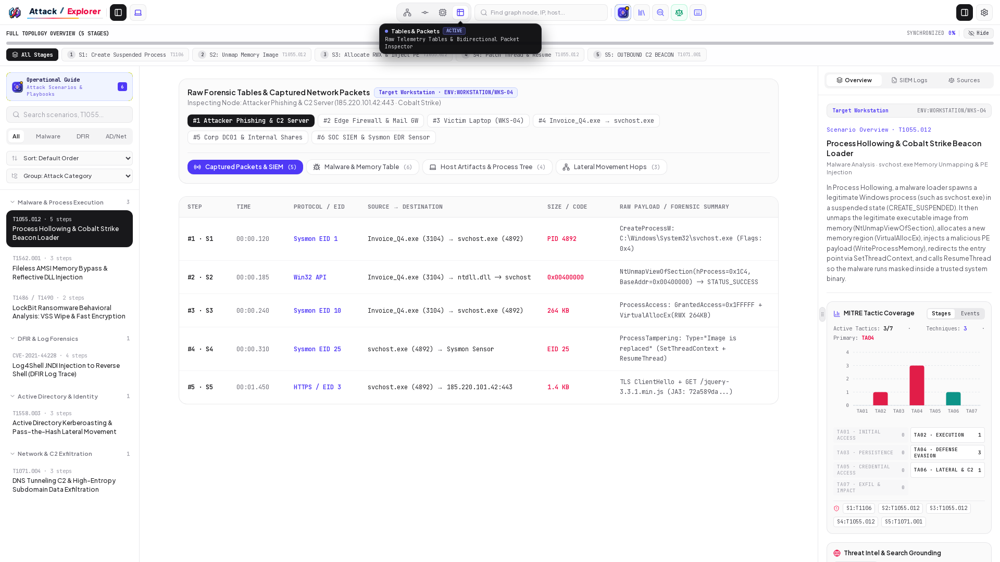
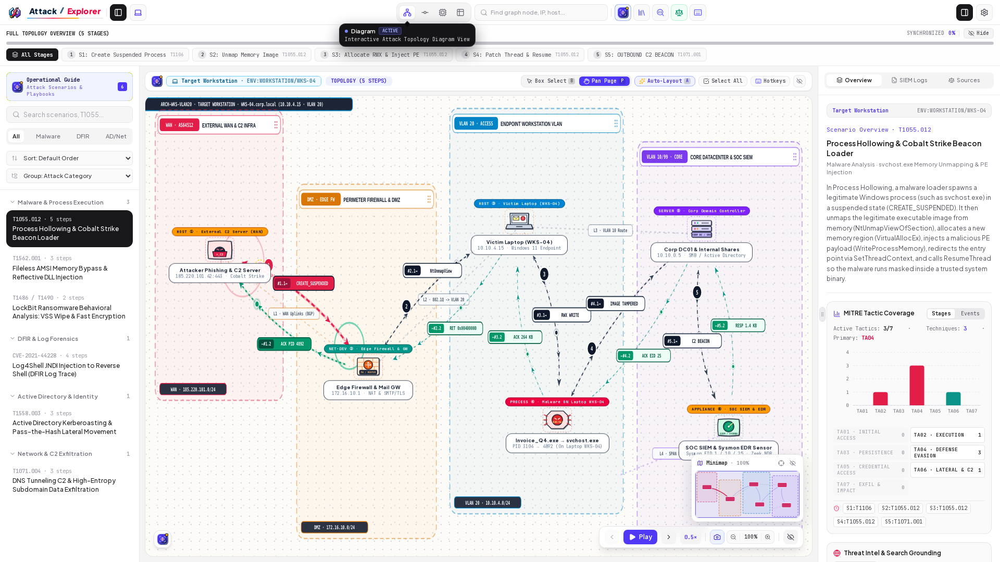

# Attack Explorer

# [https://www.attackexplorer.com/](https://www.attackexplorer.com/)

Live product: **[www.attackexplorer.com](https://www.attackexplorer.com/)**

Interactive workbench for exploring cyber-attack scenarios: kill-chain visuals, Sysmon/SIEM-style telemetry, and MITRE ATT&CK mapping.

## Screenshots

### Workbench overview

[](https://www.attackexplorer.com/)

### Sequence view

[](https://www.attackexplorer.com/)

### Memory forensics

[](https://www.attackexplorer.com/)

### Tables & packets

[](https://www.attackexplorer.com/)

### Scenarios sidebar

[](https://www.attackexplorer.com/)

## Setup

```bash
npm install
cp .env.example .env.local
npm run dev
```

Optional in `.env.local`:

```env
GEMINI_API_KEY=your_key
APP_URL=http://localhost:3000
```

## Scripts

| Command | Purpose |
| --- | --- |
| `npm run dev` | Development server |
| `npm run build` | Production build |
| `npm start` | Run production build |

## API

```http
GET /api/attacks?category=ALL&mitrePhase=ALL&severity=ALL&search=
```

## Docs

- [UI & Canvas Engineering Standards](./docs/ui-canvas-engineering-standards.md)

## Credits

Original idea inspired by **[Dilum Sanjaya](https://x.com/DilumSanjaya)**.
