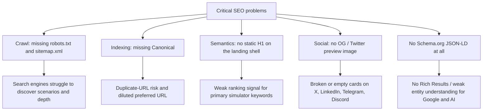

# Module 01: Executive Summary & Health Scorecard

This report summarizes a deep audit of **Attack Explorer** using Next.js 15 code review plus a specialized search-engine crawl (`squirrelscan`, reported as v0.0.182 at audit time).

Scores below are a **snapshot**. Re-measure after implementing P0 fixes; do not claim a new overall score until a fresh scan confirms it.

---

## 1. Key health scores

| Metric | Score | Status | Target | Primary drag on score |
| :--- | :---: | :---: | :---: | :--- |
| **Overall** | **33 / 100** | Fail (F) | > 90 | Base crawl failures (missing `robots` + `sitemap`) applied a large penalty (~62% impact on overall). |
| **Technical / base SEO** | **48 / 100** | Critical | > 95 | No landing `<h1>`, no `robots.txt`, no `sitemap.xml`, no `canonical`. |
| **Crawlability** | **58 / 100** | Critical | 100 | Missing crawl-control and sitemap files. |
| **Core SEO** | **72 / 100** | Needs work | 100 | Weak heading structure and missing `canonical`. |
| **Trust / E-E-A-T** | **57 / 100** | Weak | > 80 | No crawlable About, contact, author, or privacy links in the HTML body. |
| **AI agent experience** | **90 / 100** | Good | 100 | Accessible, but needs `llms.txt` and better visible-text / token weight. |
| **Performance** | **89 / 100** | Acceptable | > 90 | Large DOM (~1515 nodes) and two critical CSS request chains. |
| **Security headers** | **85 / 100** | Good | > 95 | Missing CSP, clickjacking protection, and `security.txt`. |

---

## 2. Critical blockers

---

## 3. Priority action matrix

| Priority | Action | Rough effort | Related files | Expected impact |
| :---: | :--- | :---: | :--- | :---: |
| **P0** | Add standards-based `robots.ts` and `sitemap.ts` | ~15 min | `app/robots.ts`, `app/sitemap.ts` | Large crawlability recovery (~+35 on overall if crawl penalty clears) |
| **P0** | Add a server-rendered `<h1>` (visible or `sr-only`) | ~5 min | `app/layout.tsx` or `components/AttackHeader.tsx` | Strong core-SEO signal (~+15) |
| **P0** | Set `metadataBase` + `alternates.canonical` | ~5 min | `app/layout.tsx` | Duplicate-content control (~+10) |
| **P1** | Inject JSON-LD (`WebApplication` + `TechArticle`) | ~20 min | `app/layout.tsx` | Entity understanding / Rich Results eligibility |
| **P1** | Ship OG / Twitter image (`opengraph-image` or `public/og-image.png`) | ~10 min | `app/layout.tsx`, `app/` or `public/` | Social CTR |
| **P2** | Add `public/llms.txt` for GEO / AI answer engines | ~10 min | `public/llms.txt` | Better agent grounding |
| **P2** | Add security headers + `security.txt` | ~15 min | `next.config.ts`, `public/.well-known/security.txt` | Trust / security score |

---

## 4. Extra notes for Attack Explorer specifically

- The product is a **heavy interactive workbench**. Treat SEO as “indexable shell + deep scenario documentation,” not “make every canvas node crawlable.”
- Prefer investing crawl budget in **real scenario/docs URLs** over every query-string UI state (`?mode=`, playback position, drawer open).
- Keep marketing title/description aligned with the existing product line: *Visual Cyber Attack, Log & Malware Analyzer mapped to MITRE ATT&CK* — do not invent alternate brand claims.
- After P0, wire Search Console property verification and submit `/sitemap.xml` once.
